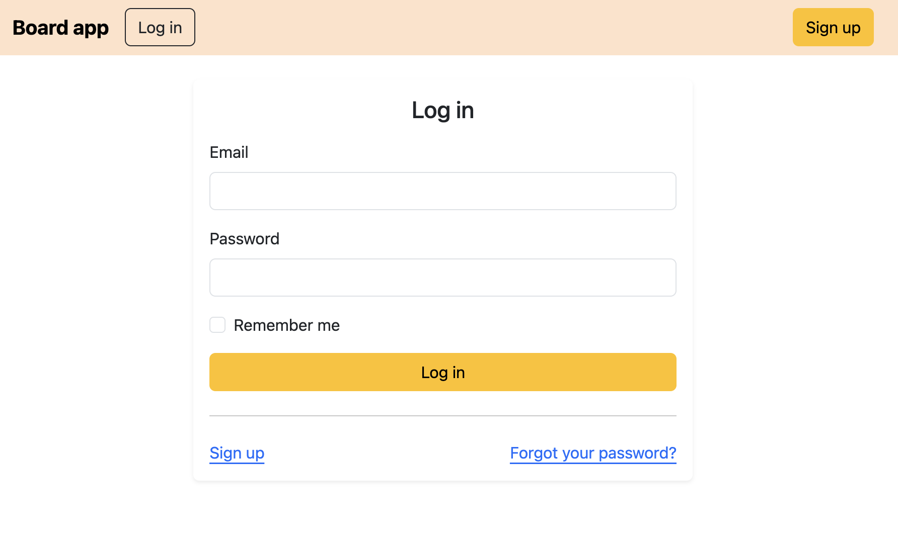
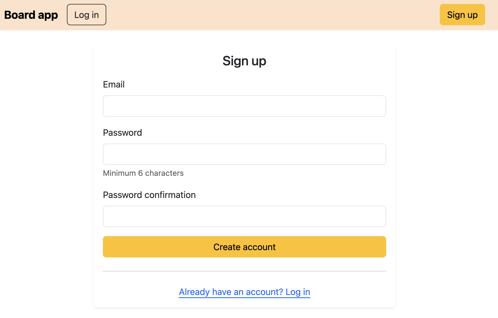
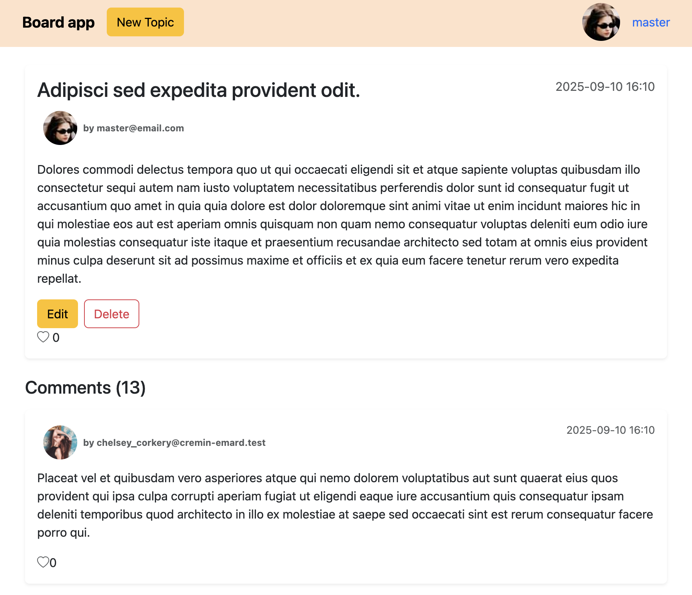
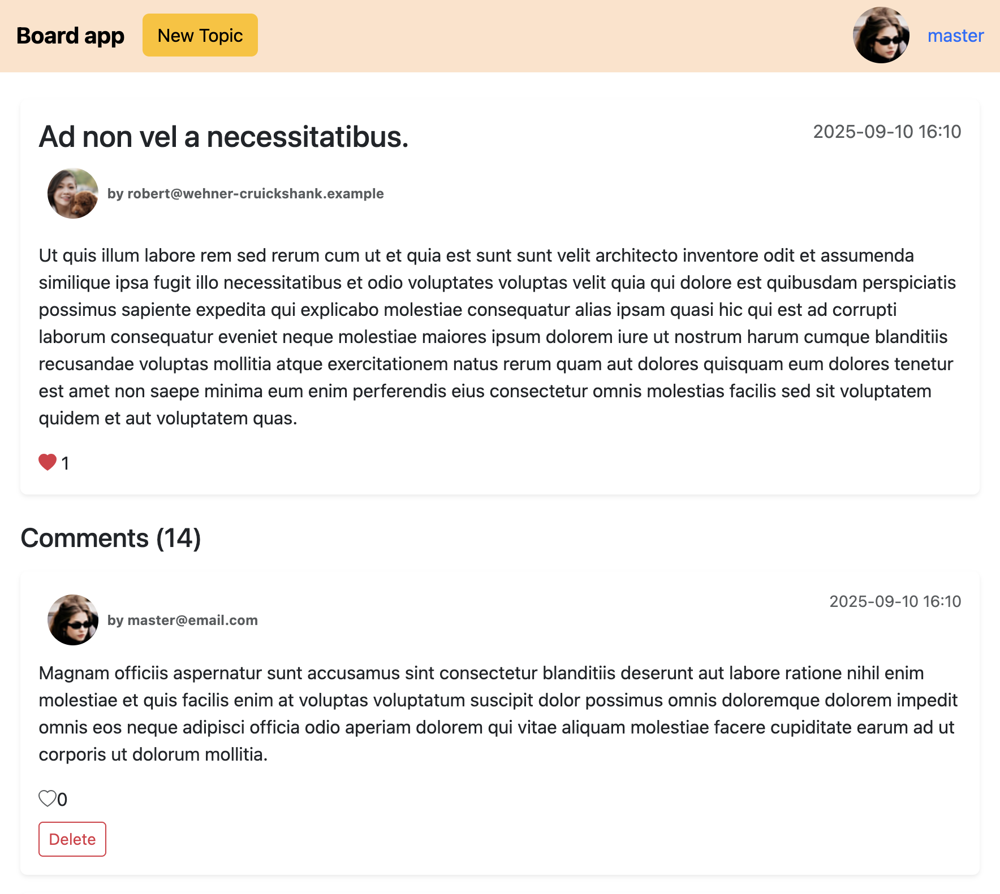
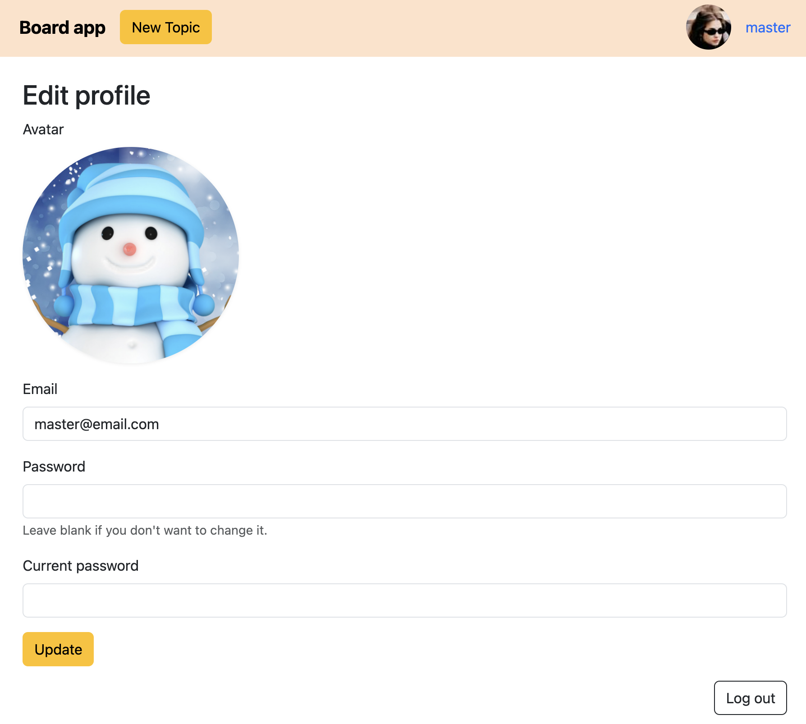
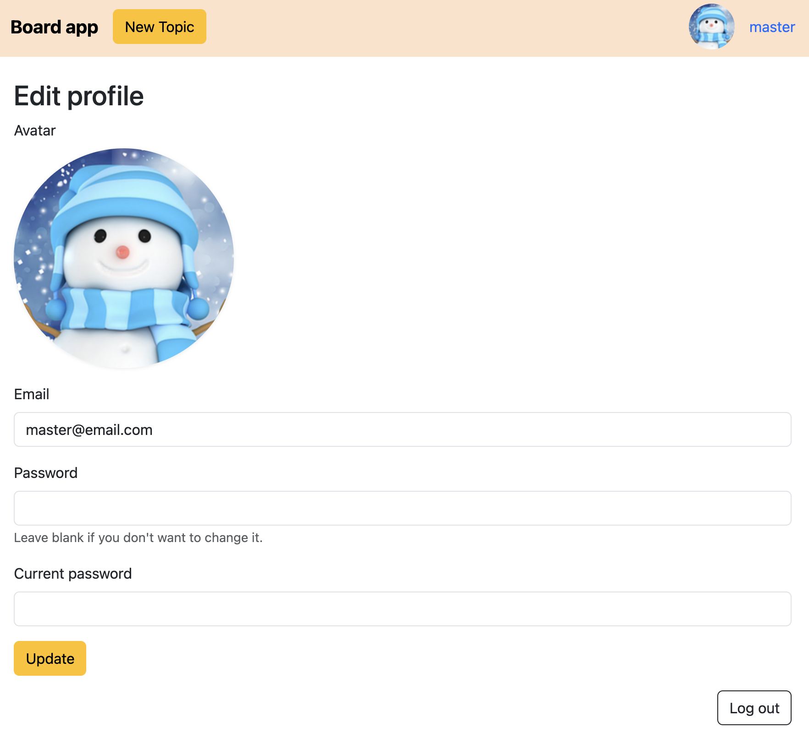
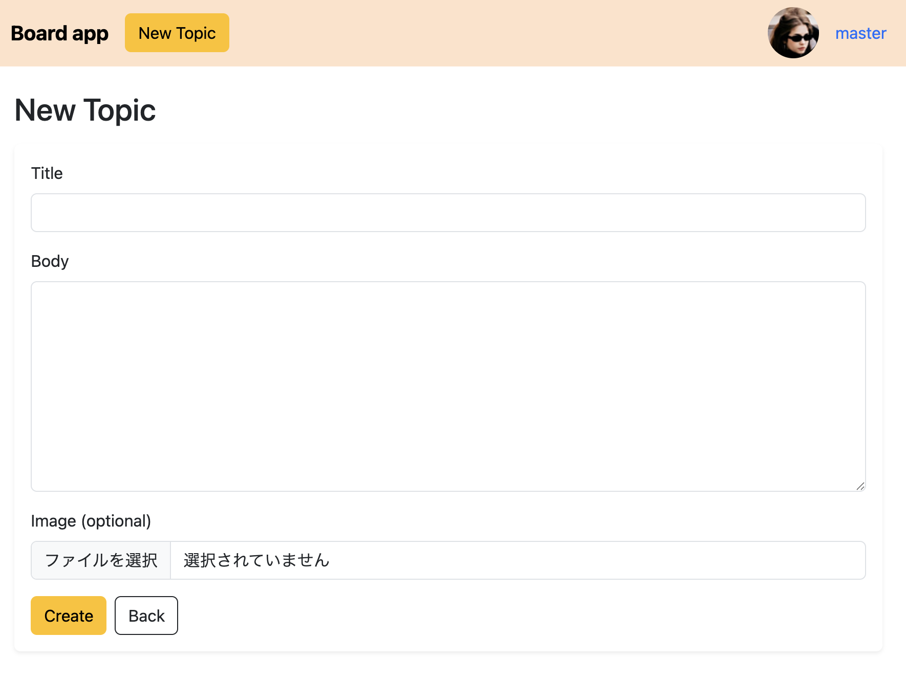
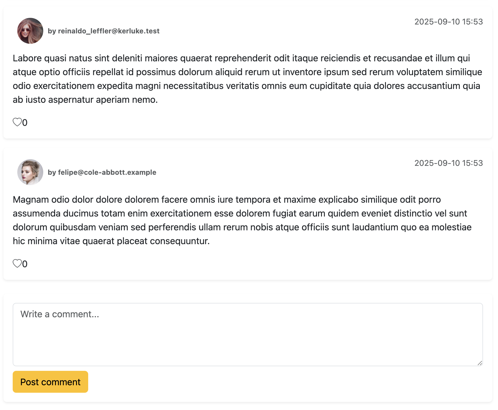

# README

# Board App

シンプルな掲示板アプリです。  
ユーザー登録後、トピックの作成・編集・削除、コメント、いいねができます。  
アバター画像の設定や検索機能も備えています。

## System dependencies
- ruby 3.2.5
- Rails 7.2.2.2
- postgres (PostgreSQL) 14.19 (Homebrew)
- Node.js 22.11.0
- Yarn 1.22.22

## 主な機能
- ユーザー登録 / ログイン (Devise)
- プロフィール編集（アバター画像アップロード）
- トピックの CRUD
- コメント機能
- いいね機能 (非同期)
- トピック検索（タイトル・本文）
- ページネーション (Pagy + Bootstrap)

## 使用技術
- フロントエンド: Haml, SCSS, Bootstrap
- バックエンド: Ruby on Rails 7
- データベース: PostgreSQL
- 認証: Devise
- 画像アップロード: ActiveStorage
- ページネーション: Pagy
- 開発環境: macOS, VS Code

## セットアップ方法
```
bash
# リポジトリをクローン
git clone https://github.com/ユーザー名/リポジトリ名.git
cd リポジトリ名

# 必要なパッケージをインストール
bundle install
yarn install

# DB 作成 & マイグレーション
bin/rails db:create db:migrate db:seed

# サーバー起動
bin/dev
```

## デモ画面

<table>
  <tr>
    <td></td>
    <td></td>
  </tr>
</table>

<table>
  <tr>
    <td></td>
    <td></td>
  </tr>
</table>

<table>
  <tr>
    <td></td>
    <td></td>
  </tr>
</table>

<table>
  <tr>
    <td></td>
    <td></td>
  </tr>
</table>

## 工夫したポイント

- ユーザーごとにアバターを設定できるようにした
- トピックとコメントが見やすいカードデザイン
- Bootstrap とカスタム SCSS を組み合わせた配色調整
- Pagy を使ったシンプルで高速なページネーション

## 学習背景
- Rails の基礎を理解するために作成
- エラー対応やコード改善に ChatGPT を補助ツールとして活用し、自分で調べながら実装しました。
